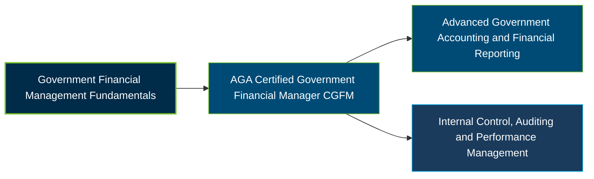

# AGA Certified Government Financial Manager (CGFM) Certification Exam Guide

A dedicated, comprehensive study guide and government financial management reference repository for candidates preparing for the **AGA Certified Government Financial Manager (CGFM) Certification**.

---

## Exam Overview

The AGA Certified Government Financial Manager (CGFM) certification validates professional knowledge of governmental accounting, financial reporting, budgeting, auditing, internal controls, and financial management across government organizations.

- **Exam Format**: Three separate computer-based, multiple-choice examinations administered through Pearson VUE testing centers or online proctoring.
- **Target Audience**: Government Accountants, Financial Managers, Budget Analysts, Auditors, Financial Reporting Specialists, and Public-Sector Finance Professionals.
- **Prerequisites**: A bachelor's degree or higher from an accredited U.S. college or university and agreement to follow AGA's Code of Ethics are required before taking the examinations. Two years of professional-level U.S. government financial management experience are required before the CGFM designation is awarded.

---

## Core Exam Domains & Knowledge Areas

### 1. Examination One — Governmental Environment

- Government structure, levels of government, legal authority, public-sector responsibilities, and the governmental financial environment.
- Budget processes, governmental financing, taxation, grants, public debt, accountability, and fiscal sustainability.
- Government ethics, transparency, electronic services, cybersecurity, and public-sector information management.

### 2. Examination Two — Governmental Accounting, Financial Reporting and Budgeting

- Governmental accounting principles, financial reporting standards, managerial cost accounting, and budget development and control.
- State and local government accounting, GASB standards, fund accounting, Annual Comprehensive Financial Reports (ACFRs), and financial statements.
- Federal financial accounting, FASAB standards, federal budgetary and proprietary accounting, and agency financial reporting.

### 3. Examination Three — Governmental Financial Management and Control

- Cash and investment management, procurement, property and inventory management, financial systems, and project management.
- Financial and managerial analysis, data analytics, internal controls, enterprise risk management, and fraud prevention.
- Performance measurement, service efforts and accomplishments, government auditing standards, and audit responsibilities.

---

## Certification Path

The following diagram presents a suggested learning progression for government financial management. It is not an official AGA certification pathway.

---

## Recommended Practice & Study Resources

Use official AGA examination outlines as the foundation for preparation, supported by study materials and practical public-sector financial management exercises.

- **CertsGate**: Explore [AGA CGFM certification exam preparation resources](https://certsgate.com/exams/aga/cgfm), including supplementary study materials and practice questions to reinforce government accounting and financial management knowledge.
- **Practical Study Resources**: Strengthen your understanding of GASB and FASAB standards, GAO internal control guidance, Uniform Guidance, governmental financial statements, budgeting, and audit scenarios through practical review and application.
